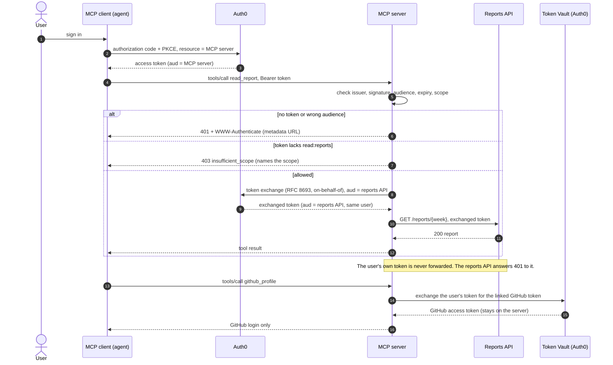

# Auth0 MCP Demo

[](https://github.com/ExpertVagabond/auth0-mcp-demo/actions/workflows/test.yml)
[](LICENSE)
[](https://nodejs.org/)
[](https://codespaces.new/ExpertVagabond/auth0-mcp-demo)

One MCP server, protected by Auth0, and one story: **who can call which tool, and how everything else is refused.**

- Every access token is checked: issuer, signature, audience, expiry, and a permission per tool.
- To call a backend for the user, the server **exchanges** the user's token (on-behalf-of) instead of forwarding it.
- It reaches GitHub through **Token Vault**, so the user's GitHub token never leaves the server.


## One demo, two ways to run it

The server code (`server.mjs`) and the backend (`reports-api.mjs`) are the same in both. Only the authorization server changes.

| | **Local** | **Live** |
|---|---|---|
| Authorization server | A stand-in on your machine that signs real RS256 tokens | Your Auth0 tenant |
| You need | Node.js 22 and git | Plus a free Auth0 account and a browser sign-in |
| First run | 2 minutes | About 20 minutes, mostly tenant setup |
| Command | `npm run demo` | `npm start`, `npm run login`, `npm run check` |
| Guide | [Step 1](guide/01-run-locally.md) | [Steps 2 and 3](guide/02-set-up-auth0.md), plus [step 4](guide/04-token-vault.md) for GitHub |

Start local. Go live when you want to see it against Auth0. Verified live on 2026-10-21 and rechecked end to end on 2026-11-10.

## The six requests

The demo sends six requests. Five are refused with a named reason, and one is allowed:

| # | Request | Result | What it proves | Live check |
|---|---|---|---|---|
| 1 | No token | **401** + where to log in, and which scopes | A client can discover the authorization server itself | ✅ |
| 2 | A real token, issued for another API | **401** | Signed isn't enough; it must be issued for *this* server | — |
| 3 | Valid token, missing `read:reports` | **403**, names the scope | Known user, not allowed, told exactly what's missing | — |
| 4 | Valid token with `read:reports` | **200** after a token exchange | The backend gets its own token for the same user | ✅ `npm run check` |
| 5 | The user's token sent straight to the backend | **401** | No token passthrough, no confused deputy | ✅ |
| 6 | Broken JSON, then a body over 1 MB | **400**, **413** | Clean errors, and the server keeps running | — |

"Live check" marks what [step 3](guide/03-run-against-auth0.md) shows against a real tenant. Requests 2, 3 and 6 need forged tokens or inputs, so they run locally only. Token Vault (the GitHub tools) is live only.

## Related content

- [Auth for MCP](https://auth0.com/ai/docs/mcp/overview): how Auth0 secures MCP servers.
- [On-Behalf-Of Token Exchange](https://auth0.com/docs/secure/call-apis-on-users-behalf/on-behalf-of-token-exchange): calling your own APIs for the user.
- [Token Vault](https://auth0.com/docs/secure/call-apis-on-users-behalf/token-vault): calling third-party APIs for the user.
- [MCP authorization specification](https://modelcontextprotocol.io/specification/latest/basic/authorization): what MCP clients and servers must do.

## Guide

| Step | Guide | |
|---|---|---|
| 0 | [Prerequisites](guide/00-prerequisites.md) | |
| 1 | [Run it locally](guide/01-run-locally.md) | **Local** |
| 2 | [Set up Auth0](guide/02-set-up-auth0.md) | **Live** |
| 3 | [Run it against Auth0](guide/03-run-against-auth0.md) | **Live** |
| 4 | [Add GitHub through Token Vault](guide/04-token-vault.md) (optional) | **Live** |
| 5 | [Present it](guide/05-present-it-live.md): a five-minute script | Local |

Stuck? Run `npm run doctor`, then see [Troubleshooting](guide/troubleshooting.md).

## Requirements

- [Node.js](https://nodejs.org/en/download) 22 or later, and npm
- [git](https://git-scm.com)
- For live: an [Auth0](https://auth0.com/signup) account and tenant
- For GitHub through Token Vault: a [GitHub OAuth app](https://docs.github.com/en/apps/oauth-apps/building-oauth-apps/creating-an-oauth-app) you own

## Download and run (local)

```bash
git clone https://github.com/ExpertVagabond/auth0-mcp-demo.git
cd auth0-mcp-demo
npm install
npm run doctor           # preflight: checks Node, dependencies and (later) your Auth0 settings
npm run demo -- --step   # press Enter to move through the six requests
```

Or open it in [GitHub Codespaces](https://codespaces.new/ExpertVagabond/auth0-mcp-demo) and run the same commands there.

**Using a coding agent?** Point it at [AGENTS.md](AGENTS.md). It has exact commands and success criteria, and `npm run demo -- --json` gives a machine-readable result.

Run the tests with `npm test` (23 tests).

## How it works



## Tools

| Tool | Requires | Returns |
|---|---|---|
| `whoami` | A valid token | The token's subject and scopes |
| `read_report(week)` | `read:reports` | The week's report, fetched from the reports API with an exchanged token. `week` is `YYYY-Www` |
| `github_profile` | `read:github`, a linked GitHub account | The linked GitHub login, through Token Vault |
| `github_open_prs` | `read:github`, a linked GitHub account | The user's open pull requests on public repositories |

The GitHub tools appear only when token exchange is configured.

## Repository layout

| Path | What it is |
|---|---|
| `server.mjs` | The MCP server: token checks, per-tool permissions, token exchange, Token Vault tools |
| `reports-api.mjs` | The backend the MCP server calls for the user |
| `scripts/walkthrough.mjs` | The six-step demo (`npm run demo`, `--step` to present, `--json` for agents) |
| `scripts/doctor.mjs` | Preflight (`npm run doctor`): what's ready, what's missing, and how to fix it |
| `AGENTS.md` | Instructions and success criteria for coding agents |
| `scripts/login-check.mjs`, `live-check.mjs`, `connect-github.mjs` | Sign-in, tool check and account linking against a real tenant |
| `test/` | The test suite, and the stand-in issuer shared with the demo |
| `guide/` | Step-by-step guide, steps 0 to 5 |
| `docs/` | [MCP spec check](docs/MCP-SPEC-CHECK.md), [developer-experience findings](docs/FRICTION.md), the [docs review](docs/DOCS-REVIEW.md), the [verification log](docs/VERIFICATION.md), and a saved demo run |
| `.env.example` | Every setting for steps 3 and 4, explained |
| `.devcontainer/`, `.nvmrc` | A reproducible Node 22 environment (Codespaces or VS Code) |
| `log-receiver/` | A Cloudflare Worker that receives the tenant's log stream |

## Security

This repository contains no tenant credentials, client secrets or tokens. Settings go in `.env` and tokens in `.tokens/`, and git ignores both. The `.demo.test` identifiers and every credential in the tests are non-production fixtures.

## License

[MIT](LICENSE)
