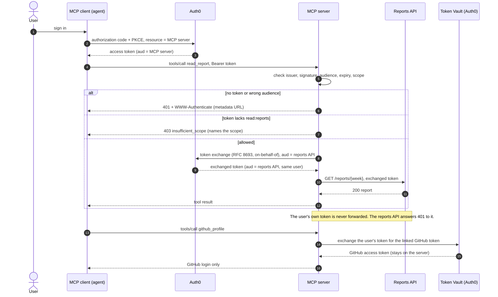

# auth0-mcp-demo

**An AI agent's tools (an MCP server) protected by Auth0, showing who can call what and how everything else is refused.**

- The server checks every access token: issuer, signature, audience and expiry, plus a permission per tool.
- To call a backend for the user, it **exchanges** the user's token (on-behalf-of) instead of forwarding it.
- It reaches GitHub through **Token Vault**, so the GitHub token never leaves the server.

Verified against a live Auth0 tenant: first on 2026-10-21, rechecked end to end on 2026-11-10. The local demo and 23 tests pass as of 2026-11-10.

---

## Run the demo (2 minutes, no account)

You need [Node.js 22+](https://nodejs.org/en/download) and `git`.

```bash
git clone https://github.com/ExpertVagabond/auth0-mcp-demo.git
cd auth0-mcp-demo
npm install
npm run demo -- --step     # press Enter to move through each step
```

It starts three local services (a stand-in for Auth0 that signs real tokens, the MCP server and a reports API), then sends six requests:

| # | What it tries | Result | What it proves |
|---|---|---|---|
| 1 | No token | **401** + where to log in | The client can discover the authorization server itself |
| 2 | A real token, issued for another API | **401** | Signed isn't enough; it must be issued for *this* server |
| 3 | Valid token, missing `read:reports` | **403**, names the scope | Known user, not allowed, and told exactly what's missing |
| 4 | Valid token with `read:reports` | **200** after a token exchange | The backend gets its own token for the same user |
| 5 | User's token sent straight to the backend | **401** | No token passthrough, no confused deputy |
| 6 | Broken JSON, then a body over 1 MB | **400**, **413** | Clean errors, and the server keeps running |

The run ends with a summary and `All 6 steps matched their expected status.` Drop `-- --step` to run straight through. A saved run is in [`docs/walkthrough-output.txt`](docs/walkthrough-output.txt).


**Presenting it live?** [DEMO.md](DEMO.md) is the script: what to type, what appears and what to say at each step.

**Run the tests:** `npm test` (23 tests, all passing).

---

## How a request flows



---

## Run it against a real Auth0 tenant

[REPRODUCE.md](REPRODUCE.md) walks through it in nine numbered steps: tenant settings, the two APIs, the role, the login app, the token-exchange app, running both servers, signing in, and linking GitHub through Token Vault. Each step links to the official Auth0 docs, and a troubleshooting table covers the real errors hit along the way.

---

## What's in the repo

| File | What it is |
|---|---|
| `server.mjs` | The MCP server: token checks, per-tool permissions, token exchange, Token Vault tools |
| `reports-api.mjs` | The backend the MCP server calls on the user's behalf |
| `scripts/walkthrough.mjs` | The six-step demo (`npm run demo`) |
| `scripts/login-check.mjs`, `live-check.mjs`, `connect-github.mjs` | Live checks against a real tenant (see REPRODUCE.md) |
| `test/` | The test suite and the mock issuer shared with the demo |
| `REPRODUCE.md`, `DEMO.md` | Step-by-step setup, and the presenter script |
| `FRICTION.md`, `DOCS-REVIEW.md` | Developer-experience findings from building this, written as product feedback |
| `log-receiver/` | A Cloudflare Worker that receives the tenant's log stream |

---

<details>
<summary><b>Verified against a live tenant (2026-10-21, rechecked 2026-11-10)</b></summary>

The checks below ran against a development tenant. The tenant hostname and credentials are intentionally not committed.

**Recheck, 2026-11-10:** browser login (authorization code + PKCE, via GitHub) returned a token with `read:reports` and `read:github`. With it, `live-check.mjs` passed `whoami`, `read_report` through a live on-behalf-of exchange, `github_profile` and `github_open_prs` through Token Vault. The same user token sent straight to the reports API got 401. A machine-to-machine token passed `whoami`, and the exchange refused it, as it should, with `The user is not found`: on-behalf-of needs a user.

- **Machine-to-machine token:** `scripts/live-check.mjs` called `whoami` and `read_report`.
- **Browser login:** `scripts/login-check.mjs` ran the authorization-code flow with PKCE. The user signed in with Google and got the Report Reader role. `live-check.mjs` then passed with that user's token.
- **On-behalf-of token exchange:** the MCP server exchanges the user's token for one whose audience is the reports API. The reports API accepts the exchanged token (200) and refuses the user's own MCP token (401).
- **Token Vault:** a GitHub account is linked through Connected Accounts, using a GitHub OAuth app owned by the developer. `scripts/connect-github.mjs` runs the link. The MCP server's `github_profile` tool exchanges the user's token through Token Vault and returns the linked GitHub login. A live run returned `github_login` for the linked user. `github_open_prs` lists the user's open pull requests the same way. It returns public pull requests only, because the connection requests no GitHub scopes.
- **MCP client:** a first-party app created ahead of time (`mcp-client.json` in the local config, not the repo) logs users in with Google or GitHub, and its token works for every tool. Dynamic client registration is off: registered clients are third-party and can't use social connections on this tenant (see `FRICTION.md` item 12).
- **Spec checks:** against the MCP authorization spec, a token without the tool's scope gets HTTP 403 with a `WWW-Authenticate` challenge that names the scope. Clients send the `resource` parameter by default.
- **Log stream:** an HTTP log stream sends tenant events to a Cloudflare Worker, `log-receiver/`. The Worker checks a bearer token and logs only event counts and types.

</details>

<details>
<summary><b>Reference: endpoints, tools, reports API, environment variables</b></summary>

### Endpoints

- `GET /.well-known/oauth-protected-resource`: protected-resource metadata (RFC 9728), pointing clients at the issuer.
- `POST /mcp`: MCP over streamable HTTP. Requires `Authorization: Bearer <token>`. A missing or invalid token gets a 401 with a `WWW-Authenticate` challenge that points at the metadata.

### Tools

- `whoami`: returns the token's subject and scopes. No scope required.
- `read_report(week)`: requires `read:reports`. Without it, the tool returns an error result with `insufficient_scope`. With it, the tool fetches the week from the reports API. The week must match `YYYY-Www`.
- `github_profile`: returns the GitHub login linked to the user through Token Vault. Requires `read:github`.
- `github_open_prs`: lists the user's open pull requests on public repositories, through Token Vault. Requires `read:github`.

The two GitHub tools are registered only when token exchange is configured: `TOKEN_EXCHANGE_CLIENT_ID`, `TOKEN_EXCHANGE_CLIENT_SECRET`, and `REPORTS_AUDIENCE` are all set.

### Reports API

`reports-api.mjs` serves `GET /reports/{week}`. Callers send `Authorization: Bearer <token>`, and the API accepts only tokens that:
- are signed by the issuer and have audience `REPORTS_AUDIENCE` (`https://reports-backend.demo.test/`), and
- carry `read:reports` in the `permissions` claim.

The user's own token is never forwarded; the MCP spec forbids token passthrough. Instead, the MCP server exchanges the user's token (RFC 8693, Auth0 on-behalf-of) for one whose audience is the reports API. The exchange result is cached until shortly before it expires. Exchanged tokens carry `permissions` but no `scope` claim.

### Environment variables

| Variable | Used by | Meaning |
|---|---|---|
| `AUTH0_ISSUER` | server, reports API | Tenant issuer with a trailing slash, e.g. `https://YOUR-TENANT.us.auth0.com/` |
| `MCP_RESOURCE` | server, login check | The MCP server's API identifier; tokens must carry it as their audience |
| `PORT` | server, reports API | Listen port (server default 3000) |
| `REPORTS_API_URL` | server | Where the reports API runs, e.g. `http://localhost:3100` |
| `REPORTS_AUDIENCE` | server, reports API | The reports API's identifier, `https://reports-backend.demo.test/` |
| `TOKEN_EXCHANGE_CLIENT_ID`, `TOKEN_EXCHANGE_CLIENT_SECRET` | server | The on-behalf-of exchange application. Keep the secret out of the repo |
| `AUTH0_DOMAIN`, `LOGIN_CLIENT_ID`, `TOKEN_OUT` | `login-check.mjs` | Tenant domain, login app, where to save the token |
| `MCP_URL`, `TOKEN_FILE` | `live-check.mjs` | The running MCP server and a saved token |
| `ME_TOKEN_FILE` | `connect-github.mjs` | A My Account API token file |

</details>

## Security

This repository contains no tenant credentials, OAuth client secrets, access tokens, linked-account tokens, or local token files. Supply all credentials through environment variables and keep generated token files outside the repository. The identifiers ending in `.demo.test` and all credentials in the automated tests are non-production fixtures.
