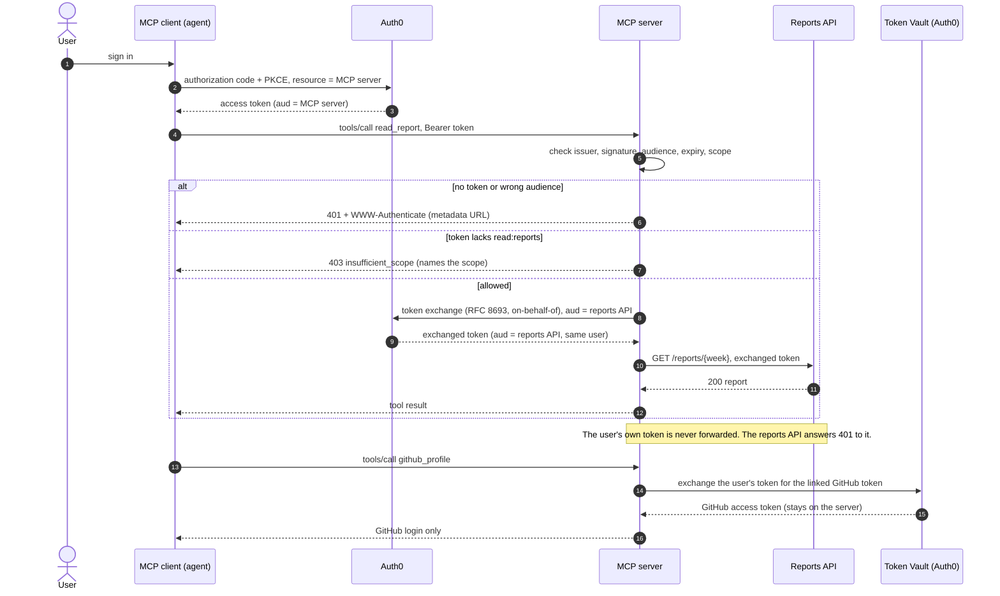

# MCP Agent Identity with Auth0

[](https://github.com/ExpertVagabond/mcp-agent-identity-auth0/actions/workflows/test.yml)
[](LICENSE)
[](https://nodejs.org/)
[](https://codespaces.new/ExpertVagabond/mcp-agent-identity-auth0)

One MCP server, protected by Auth0, and one story: **who can call which tool, and how everything else is refused.**

- Every access token is checked: issuer, signature, audience, expiry, and a permission per tool.
- To call a backend for the user, the server **exchanges** the user's token (on-behalf-of) instead of forwarding it.
- It reaches GitHub through **Token Vault**, so the user's GitHub token never leaves the server.

## What it's for

A working reference for giving an AI agent **scoped, delegated access** through an MCP server, with Auth0 as the authorization server. Use it to:

- **Learn the pattern.** Six requests show each rule allowing or refusing, with the reason.
- **Start your own server.** Add your own tools, point it at your own API, or add another provider. [Step 6](guide/06-build-on-it.md) has the recipes.
- **Teach it.** The six requests double as a workshop sequence, and [step 5](guide/05-present-it-live.md) is the script.
- **Test authorization in CI.** The stand-in issuer runs the same checks with no tenant.

| Your agent needs to... | Pattern in this repo | See |
|---|---|---|
| Read your own company API for the signed-in user | On-behalf-of token exchange: the backend gets its own token for the same user | `read_report`, [recipe 2](guide/06-build-on-it.md#2-call-your-own-api-for-the-user) |
| Act in a SaaS account the user already has (GitHub, Google, Slack, ...) | Token Vault: the provider token stays on the server | `github_profile`, [recipe 3](guide/06-build-on-it.md#3-reach-another-third-party-api-through-token-vault) |
| Offer some tools to some users and not others | Per-tool permissions, with a 403 that names the missing scope | `TOOL_SCOPES`, [recipe 1](guide/06-build-on-it.md#1-add-your-own-protected-tool) |
| Work with any standard MCP client | Protected-resource metadata and a 401 that says where to sign in | Request 1, [recipe 4](guide/06-build-on-it.md#4-connect-a-standard-mcp-client) |

It's a reference implementation, not a production service. [Recipe 5](guide/06-build-on-it.md#5-run-it-beyond-localhost) lists what to add before you deploy.

## Run it in two minutes

In a fresh checkout with Node.js 22 or later:

```bash
npm ci && npm run verify
npm run demo -- --step
```

The first command runs preflight, tests, and all six requests. The second pauses before each request so you can predict the response and then see why it happened. The local run needs no Auth0 account.


## One demo, two ways to run it

The server code (`server.mjs`) and the backend (`reports-api.mjs`) are the same in both. Only the authorization server changes.

| | **Local** | **Live** |
|---|---|---|
| Authorization server | A stand-in on your machine that signs real RS256 tokens | Your Auth0 tenant |
| You need | Node.js 22 and git | Plus a free Auth0 account and a browser sign-in |
| First run | 2 minutes | About 20 minutes, mostly tenant setup |
| Command | `npm run demo` | `npm run start:api`, `npm start`, `npm run login`, `npm run check` |
| Guide | [Step 1](guide/01-run-locally.md) | [Tenant setup](guide/02-set-up-auth0.md), [live run](guide/03-run-against-auth0.md), and [optional Token Vault](guide/04-token-vault.md) |

The [verification log](docs/VERIFICATION.md) separates earlier Auth0 tenant runs from the fresh-client OAuth test against the local issuer.

## The six requests

The demo groups its checks into six requests. The fourth is the allowed path:

| # | Request | Result | What it proves | Live check |
|---|---|---|---|---|
| 1 | No token | **401** + where to log in, and which scopes | A client can discover the authorization server itself | ✅ |
| 2 | A real token, issued for another API | **401** | Signed isn't enough; it must be issued for *this* server | — |
| 3 | Valid token, missing `read:reports` | **403**, names the scope | Known user, not allowed, told exactly what's missing | — |
| 4 | Valid token with `read:reports` | **200** after a token exchange | The backend gets its own token for the same user | ✅ `npm run check` |
| 5 | The user's token sent straight to the backend | **401** | The reports API rejects a token issued for the MCP server | ✅ |
| 6 | Broken JSON, then a body over 1 MB | **400**, **413** | Clean errors, and the server keeps running | — |

"Live check" marks what [step 3](guide/03-run-against-auth0.md) shows against a real tenant. Requests 2, 3 and 6 are included in the local walkthrough. The GitHub tools have local fixture coverage and can be exercised against Auth0 through [step 4](guide/04-token-vault.md).

## Follow one report request

1. **Discover where to sign in.** With no token, `/mcp` returns `401`. Follow `resource_metadata` in `WWW-Authenticate`. The metadata names the MCP endpoint and its authorization server. The client uses that endpoint as its OAuth `resource` when it requests a token.
2. **Check audience before permission.** A correctly signed token for another API gets `401` because its `aud` targets the wrong service. A valid token for this MCP server that lacks `read:reports` gets `403`. The challenge names the missing scope so the client can request it.
3. **Exchange the credential at the next hop.** With `read:reports`, the MCP server asks the issuer for a token for the reports API, on the user's behalf. The API validates the new token and returns the report. Send the original MCP token directly to the reports API in request 5 and it returns `401` because its audience is still the MCP server.

| Token | Audience (`aud`) | How the receiving service authorizes it |
|---|---|---|
| User access token | MCP endpoint, such as `http://localhost:3000/mcp` | `read:reports` must be granted in `scope`. For the Auth0 RBAC tokens in this guide, it must also appear in `permissions`. |
| On-behalf-of access token | Reports API, such as `https://reports-backend.demo.test/` | The reports API checks `permissions` for `read:reports`. The live exchanged token in this demo had no `scope` claim. |

Both services require a valid signature, the expected issuer, an expiry (`exp`), and a subject (`sub`). The exchange preserves the user's subject while changing the audience. The two rows summarize the [token claims observed during the build](docs/FRICTION.md#8-exchanged-tokens-have-no-scope-claim-confirmed-live).

**Try it yourself.** Before advancing from request 4 to 5, predict whether the backend will accept the original token even though it has `read:reports`. Then find the audience check in [the reports API](reports-api.mjs#L30) and the exchange call in [the MCP server](server.mjs#L142). For a third-party API such as GitHub, [Token Vault](guide/04-token-vault.md) supplies a provider token to the server and the MCP client receives only the tool result.

## Related content

- [Auth for MCP](https://auth0.com/ai/docs/mcp/overview): how Auth0 secures MCP servers.
- [On-Behalf-Of Token Exchange](https://auth0.com/docs/secure/call-apis-on-users-behalf/on-behalf-of-token-exchange): calling your own APIs for the user.
- [Token Vault](https://auth0.com/docs/secure/call-apis-on-users-behalf/token-vault): calling third-party APIs for the user.
- [MCP authorization specification](https://modelcontextprotocol.io/specification/latest/basic/authorization): what MCP clients and servers must do.

## Guide

| Step | Guide | |
|---|---|---|
| 0 | [Prerequisites](guide/00-prerequisites.md) | |
| 1 | [Run it locally](guide/01-run-locally.md) | **Local** |
| 2 | [Set up Auth0](guide/02-set-up-auth0.md) | **Live** |
| 3 | [Run it against Auth0](guide/03-run-against-auth0.md) | **Live** |
| 4 | [Add GitHub through Token Vault](guide/04-token-vault.md) (optional) | **Live** |
| 5 | [Present it](guide/05-present-it-live.md): a five-minute script | Local |
| 6 | [Build on it](guide/06-build-on-it.md): your own tools, APIs and providers | Both |

Stuck? Run `npm run doctor`, then see [Troubleshooting](guide/troubleshooting.md).

## Requirements

- [Node.js](https://nodejs.org/en/download) 22 or later, and npm
- [git](https://git-scm.com)
- For live: a free [Auth0](https://auth0.com/signup) account and tenant. New tenants start with a 22-day trial, then move to the Free plan ([which plan you need](guide/00-prerequisites.md#which-auth0-plan-you-need))
- For GitHub through Token Vault: a [GitHub OAuth app](https://docs.github.com/en/apps/oauth-apps/building-oauth-apps/creating-an-oauth-app) you own

## Download and run (local)

```bash
git clone https://github.com/ExpertVagabond/mcp-agent-identity-auth0.git
cd mcp-agent-identity-auth0
npm ci
npm run doctor           # preflight: checks Node, dependencies and (later) your Auth0 settings
npm run demo -- --step   # press Enter to move through the six requests
```

Or open it in [GitHub Codespaces](https://codespaces.new/ExpertVagabond/mcp-agent-identity-auth0) and run the same commands there.

**Using a coding agent?** Point it at [AGENTS.md](AGENTS.md). It has exact commands and success criteria, and `npm run demo -- --json` gives a machine-readable result.

Run the tests with `npm test`. The suite includes a fresh SDK client that follows the 401 challenge, completes authorization code with PKCE against the local issuer, and calls `read_report`.

## How it works



## Tools

| Tool | Requires | Returns |
|---|---|---|
| `whoami` | A valid token | The token's subject and scopes |
| `read_report(week)` | `read:reports` | The week's report, fetched from the reports API with an exchanged token. `week` is `YYYY-Www` |
| `github_profile` | `read:github`, a linked GitHub account | The linked GitHub login, through Token Vault |
| `github_open_prs` | `read:github`, a linked GitHub account | The user's open pull requests on public repositories |

The GitHub tools appear only when token exchange is configured.

## Repository layout

| Path | What it is |
|---|---|
| `server.mjs` | The MCP server: token checks, per-tool permissions, token exchange, Token Vault tools |
| `reports-api.mjs` | The backend the MCP server calls for the user |
| `scripts/walkthrough.mjs` | The six-step demo (`npm run demo`, `--step` to present, `--json` for agents) |
| `scripts/doctor.mjs` | Preflight (`npm run doctor`): what's ready, what's missing, and how to fix it |
| `AGENTS.md` | Instructions and success criteria for coding agents |
| `scripts/login-check.mjs`, `live-check.mjs`, `connect-github.mjs` | Sign-in, tool check and account linking against a real tenant |
| `test/` | The test suite, and the stand-in issuer shared with the demo |
| `guide/` | Step-by-step guide, steps 0 to 5 |
| `docs/` | [MCP spec check](docs/MCP-SPEC-CHECK.md), [developer-experience findings](docs/FRICTION.md), the [docs review](docs/DOCS-REVIEW.md), the [verification log](docs/VERIFICATION.md), and a saved demo run |
| `.env.example` | Every setting for steps 3 and 4, explained |
| `.devcontainer/`, `.nvmrc` | A reproducible Node 22 environment (Codespaces or VS Code) |
| `log-receiver/` | A Cloudflare Worker that receives the tenant's log stream |

## Security

This repository contains no tenant credentials, client secrets or tokens. Settings go in `.env` and tokens in `.tokens/`, and git ignores both. The `.demo.test` identifiers and every credential in the tests are non-production fixtures.

## License

[MIT](LICENSE)
