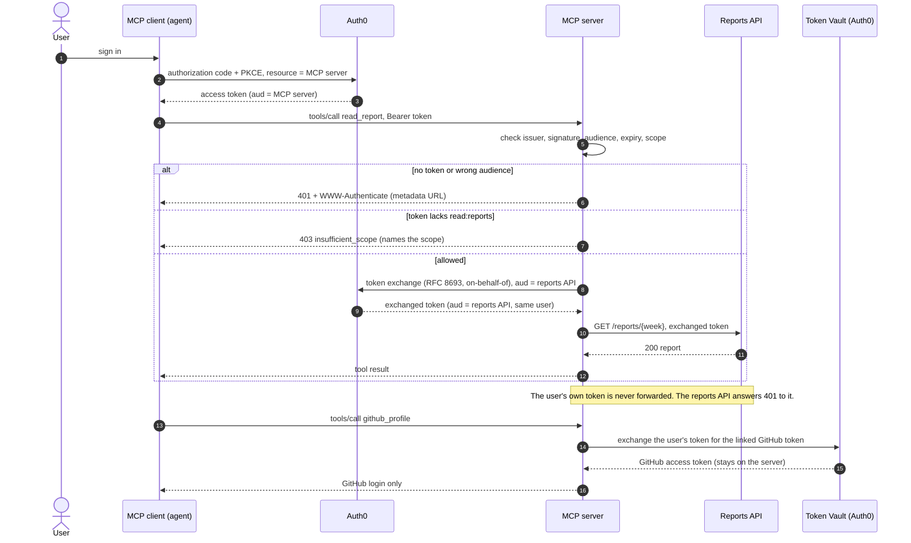

# auth0-mcp-demo

An MCP server that requires an OAuth 2.0 access token. Tokens are validated locally against the authorization server's JWKS. The server checks the issuer, the audience (the MCP resource identifier), and expiry. Tools can require a scope.

**To reproduce it step by step**, with prerequisites, a no-account local path, the full Auth0 tenant setup and links to the official docs, see [REPRODUCE.md](REPRODUCE.md).

## How a request flows

## Five-minute demo

No Auth0 tenant or sign-in needed. This starts a mock issuer, the reports API and the MCP server on free local ports, then walks through six requests and prints the status of each:

    npm install && npm run demo

Add `--step` to wait for Enter between steps:

    npm run demo -- --step

The steps: no token (401 with a metadata challenge), wrong audience (401), valid token without `read:reports` (403 `insufficient_scope`), valid token with it (on-behalf-of exchange, then the report), the user's MCP token sent straight to the reports API (401), and malformed JSON and an oversized body (400, 413). The exit code is non-zero if any status differs. A saved run is in `docs/walkthrough-output.txt`.

Status:
- **Local, rechecked 2026-11-10:** `npm test`, 23 tests, all passing (the last one runs the demo walkthrough). They use a mock issuer that signs RS256 tokens and runs token exchange.
- **Live Auth0 flows, checked 2026-10-21:** the checks below ran against a development tenant. The tenant hostname and credentials are intentionally not committed.
- **Live, machine-to-machine token:** `scripts/live-check.mjs` called `whoami` and `read_report`.
- **Live, browser login:** `scripts/login-check.mjs` ran the authorization-code flow with PKCE. The user signed in with Google and got the Report Reader role. `live-check.mjs` then passed with that user's token.
- **Live, on-behalf-of token exchange:** the MCP server exchanges the user's token for one whose audience is the reports API. The reports API accepts the exchanged token (200) and refuses the user's own MCP token (401).
- **Live, Token Vault:** a GitHub account is linked through Connected Accounts, using a GitHub OAuth app owned by the developer. `scripts/connect-github.mjs` runs the link. The MCP server's `github_profile` tool exchanges the user's token through Token Vault and returns the linked GitHub login. A live run returned `github_login` for the linked user. `github_open_prs` lists the user's open pull requests the same way. It returns public pull requests only, because the connection requests no GitHub scopes.
- **Live, MCP client:** a first-party app created ahead of time (`mcp-client.json` in the local config, not the repo) logs users in with Google or GitHub, and its token works for every tool. Dynamic client registration is off: registered clients are third-party and can't use social connections on this tenant (see `FRICTION.md` item 12).
- **Spec checks:** against the MCP authorization spec, a token without the tool's scope gets HTTP 403 with a `WWW-Authenticate` challenge that names the scope. Clients send the `resource` parameter by default.
- **Live, log stream:** an HTTP log stream sends tenant events to a Cloudflare Worker, `log-receiver/`. The Worker checks a bearer token and logs only event counts and types.

## Run the tests

    npm install
    npm test

The tests start a mock issuer that signs real RS256 tokens, start the server, and call it with an MCP client.

## Run against Auth0

Environment variables:

- `AUTH0_ISSUER`: the tenant issuer, with a trailing slash, for example `https://YOUR-TENANT.us.auth0.com/`
- `MCP_RESOURCE`: the API identifier you create in Auth0. The server accepts only tokens whose audience matches this value.
- `PORT`: optional, defaults to 3000

Then:

    AUTH0_ISSUER=https://YOUR-TENANT.us.auth0.com/ MCP_RESOURCE=https://reports.demo.test/ node server.mjs

In Auth0 you need an API whose identifier equals `MCP_RESOURCE`, with a `read:reports` scope and role-based access control enabled so the scope appears in the access token. Check the current Auth0 docs for where these settings live. This README doesn't give click-paths because they haven't been checked against a live tenant.

## Endpoints

- `GET /.well-known/oauth-protected-resource`: protected-resource metadata (RFC 9728), pointing clients at the issuer.
- `POST /mcp`: MCP over streamable HTTP. Requires `Authorization: Bearer <token>`. A missing or invalid token gets a 401 with a `WWW-Authenticate` challenge that points at the metadata.

## Tools

- `whoami`: returns the token's subject and scopes. No scope required.
- `read_report(week)`: requires `read:reports`. Without it, the tool returns an error result with `insufficient_scope`. With it, the tool fetches the week from the reports API. The week must match `YYYY-Www`.
- `github_profile`: returns the GitHub login linked to the user through Token Vault. Requires `read:github`.
- `github_open_prs`: lists the user's open pull requests on public repositories, through Token Vault. Requires `read:github`.

The two GitHub tools are registered only when token exchange is configured: `TOKEN_EXCHANGE_CLIENT_ID`, `TOKEN_EXCHANGE_CLIENT_SECRET`, and `REPORTS_AUDIENCE` are all set.

## Reports API

`reports-api.mjs` is a separate backend. It serves `GET /reports/{week}`. Callers send `Authorization: Bearer <token>`, and the API accepts only tokens that:
- are signed by the issuer and have audience `REPORTS_AUDIENCE` (`https://reports-backend.demo.test/`), and
- carry `read:reports` in the `permissions` claim.

The user's own token is never forwarded. The MCP spec forbids token passthrough. Instead, the MCP server exchanges the user's token (RFC 8693, Auth0 on-behalf-of) for one whose audience is the reports API. The exchange result is cached until shortly before it expires.

Auth0 setup for the exchange:
- A `resource_server` application whose `resource_server_identifier` is the MCP resource (`https://reports.demo.test/`), with on-behalf-of token exchange enabled. Its client secret is the `TOKEN_EXCHANGE_CLIENT_SECRET`. Keep it out of the repo.
- A client grant from that application to the reports API, for `read:reports`.
- The reports API has "Allow Skipping User Consent for Verifiable First-Party Clients" enabled, because the exchange client is first-party.

Exchanged tokens carry `permissions` but no `scope` claim.

Run it:

    AUTH0_ISSUER=https://YOUR-TENANT.us.auth0.com/ REPORTS_AUDIENCE=https://reports-backend.demo.test/ PORT=3100 node reports-api.mjs

Then start the MCP server with `REPORTS_API_URL=http://localhost:3100`, `REPORTS_AUDIENCE=https://reports-backend.demo.test/`, and `TOKEN_EXCHANGE_CLIENT_ID` and `TOKEN_EXCHANGE_CLIENT_SECRET` set from the exchange application.

## Files

- `server.mjs`: the MCP server.
- `reports-api.mjs`: the backend reports API.
- `test/e2e.test.mjs`: the test suite.
- `test/mock-issuer.mjs`: the mock issuer, token exchange and GitHub stub, shared by the tests and the demo.
- `test/walkthrough.test.mjs`: runs the demo and checks it exits 0.
- `scripts/walkthrough.mjs`: the narrated demo (`npm run demo`).
- `docs/walkthrough-output.txt`: a saved plain-text run of the demo.
- `FRICTION.md`, `DOCS-REVIEW.md`: developer-experience notes from building this.

## Security

This repository contains no tenant credentials, OAuth client secrets, access tokens, linked-account tokens, or local token files. Supply all credentials through environment variables and keep generated token files outside the repository. The identifiers ending in `.demo.test` and all credentials in the automated tests are non-production fixtures.